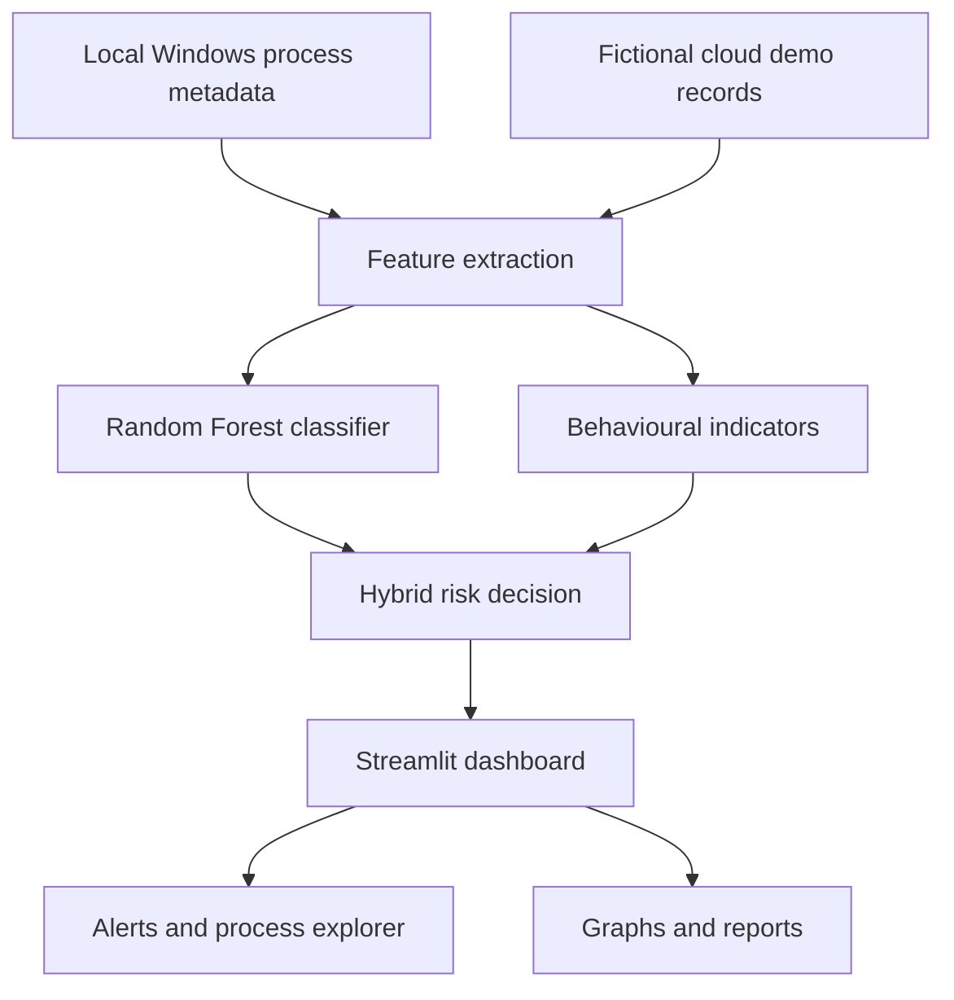
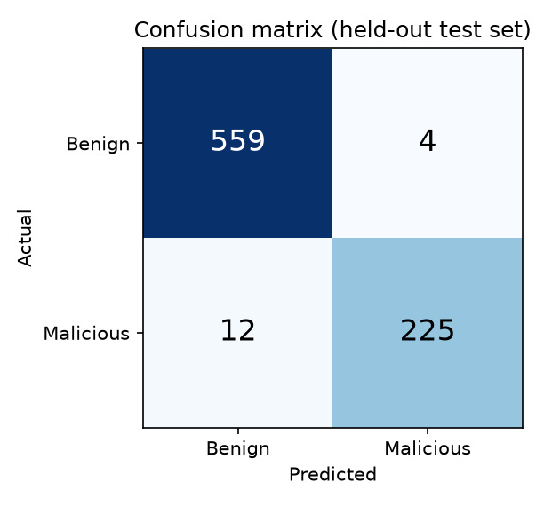
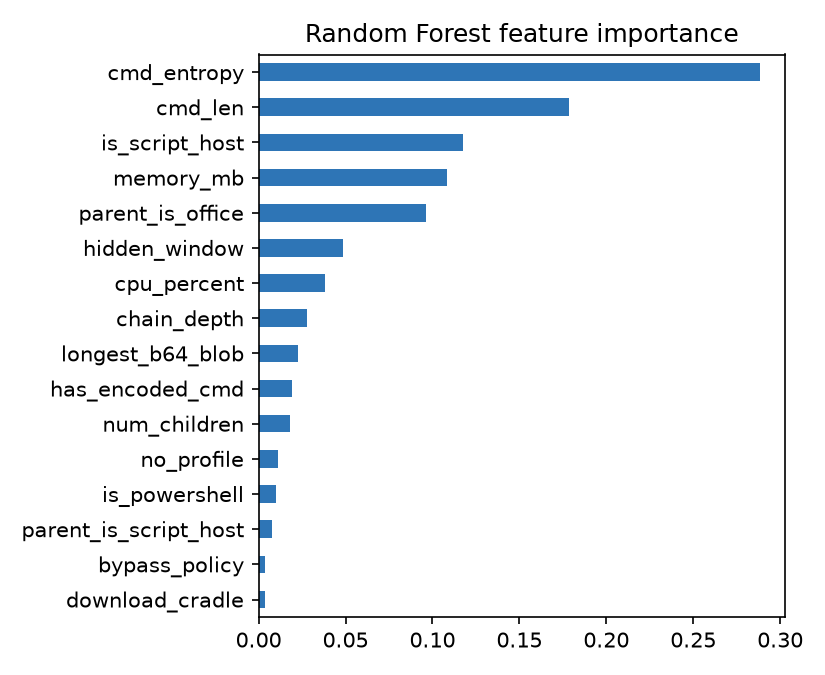

# 🛡️ FilelessGuard AI

### Intelligent Fileless Malware Detection and Suspicious Process Monitoring System

    

[](https://filelessguard-ai.streamlit.app)

**Capstone project · ITA1438 Ethical Hacking · SIMATS Engineering**

## Overview

FilelessGuard AI is a defensive cybersecurity research prototype that identifies potentially suspicious process behaviour using machine learning and interpretable behavioural rules. It combines process metadata, parent–child relationships and command-line indicators with a Random Forest classifier and an interactive OLED-style Streamlit dashboard.

The Windows edition inspects local running processes. The public cloud edition uses fictional process records only; it does not inspect visitor or server processes or execute sampled commands. Neither edition is a replacement for antivirus software.

## Live demonstration

Visit **[filelessguard-ai.streamlit.app](https://filelessguard-ai.streamlit.app)** — no local installation is required. Select **Start simulated scan**, then explore alerts, process relationships, security graphs and downloadable reports.

## Key features

- Read-only local process monitoring and optional repeated scans.
- Random Forest classification with hybrid behavioural rules.
- Explainable low-risk, needs-review and high-risk classifications.
- Interactive process relationship explorer and risk distribution charts.
- CPU and memory visualisation (live locally, illustrative online).
- Beginner and advanced dashboard modes.
- Guard Assistant: a rule-based educational guide, not a generative chatbot.
- Safe demonstration, learning centre and CSV/text report exports.
- Local-only Windows publisher checks, optional desktop notifications and scan-total history.

## System architecture



The hybrid decision requires a model score of at least 0.80 and at least two corroborating behavioural indicators for a high-risk label. A score of at least 0.50 or a corroborating indicator can trigger a needs-review label. These are review priorities, not confirmed infections or calibrated infection probabilities.

## Local vs. cloud edition

| Capability | Local V4.0 | Public cloud |
|---|---|---|
| Entry point | `app_v40.py` | `app_cloud.py` |
| Process data | Local snapshot | Fictional records |
| Classification and graphs | Yes | Yes |
| Process explorer | Yes | Simulated |
| CPU / memory | Live | Illustrative |
| Windows publisher checks and notifications | Windows only | No |
| CSV / text reports | Yes | Demo reports |
| Persistent scan totals | Optional, local | No |

## Model evaluation

The bundled Random Forest was evaluated using 3,200 synthetic training records and 800 synthetic test records.

| Metric | Held-out synthetic test result |
|---|---:|
| Accuracy | 98.00% |
| Precision | 98.25% |
| Recall | 94.94% |
| F1-score | 96.57% |

| Confusion matrix | Predicted benign | Predicted malicious |
|---|---:|---:|
| Actual benign | 559 | 4 |
| Actual malicious | 12 | 225 |

| Confusion matrix | Feature importance |
|---|---|
|  |  |

> These figures are from the bundled synthetic Random Forest evaluation (`models/metrics.json`). They are not real-world malware detection accuracy or a validation of the hybrid rules.

## Technology stack

Python · Streamlit · scikit-learn · psutil · pandas · NumPy · joblib · Matplotlib · Altair (via Streamlit) · GitHub · Streamlit Community Cloud

## Installation and usage

For local monitoring, use Windows and a Python environment compatible with the dependencies. Git is needed for cloning; alternatively download the repository ZIP.

```powershell
git clone https://github.com/jakkala-nikhil/FilelessGuard-AI.git
cd FilelessGuard-AI
python -m pip install -r requirements.txt
python -m streamlit run app_v40.py
```

Open `http://localhost:8501`. Select **Start security scan**. If the bundled model cannot be loaded because of a dependency version mismatch, regenerate it using `python train.py` in the same environment. Retraining replaces the generated model and evaluation files.

To run the simulation-only edition locally:

```powershell
python -m streamlit run app_cloud.py
```

Other commands:

```powershell
python train.py
python monitor.py --simulate --once
python -m unittest discover tests
```

The CLI uses local process snapshots even with `--simulate`; the flag adds fictional events. Optional Windows Sysmon Event ID 1 collection is available through `--sysmon` after installing Sysmon and obtaining the required permissions.

## Repository structure

```text
FilelessGuard-AI/
├── .streamlit/config.toml   # Dashboard theme
├── app_v40.py               # Local dashboard
├── app_cloud.py             # Public simulation dashboard
├── guard_v4.py              # Hybrid rules and local helpers
├── Start_FilelessGuard.bat  # Windows launcher
├── monitor.py               # Command-line monitor
├── train.py                 # Model training and evaluation
├── requirements.txt
├── models/                  # Model, metrics and evaluation charts
├── src/
│   ├── collector.py         # Process metadata collection
│   ├── features.py          # Feature extraction
│   ├── detector.py          # Classification and CLI alert logging
│   ├── data_gen.py          # Synthetic training data
│   ├── samples.py           # Fictional demonstration records
│   └── sysmon_source.py     # Optional Windows event source
└── tests/test_pipeline.py   # Unit tests
```

## Faculty demonstration (5 minutes)

1. Open the public website and introduce the research problem.
2. Start a simulated scan and explain the three risk labels.
3. Explore a flagged record and its parent–child relationships.
4. Show security graphs, model evaluation and Guard Assistant.
5. Export a demo report and discuss limitations and future work.

## Privacy, ethics and limitations

- Use local monitoring only on systems you own or are authorised to inspect.
- Local process command lines can contain sensitive information. Keep logs and private exports out of GitHub.
- The cloud edition uses fictional data; no malware execution is required.
- False positives and missed threats are possible. Do not terminate or delete processes solely because of a classification.
- The system does not perform direct memory inspection or collect API-call sequences.
- Real-world performance, hybrid rule effectiveness and cross-platform compatibility require further validation.

## Future scope

- Evaluate on authorised, representative labelled datasets.
- Personalised process-behaviour baselines and improved false-positive handling.
- PDF security reports and a standalone Windows application.
- Background monitoring with explicit consent and resource controls.

## Project team

| Role | Name |
|---|---|
| Student developer | Jakkala Nikhil |
| Student developer | Baranidharan V |
| Project guide | Gunasundari B |

**Institution:** SIMATS Engineering  
**Course:** ITA1438 — Ethical Hacking

---

**FilelessGuard AI V4.0** · Academic research prototype · Defensive cybersecurity education
